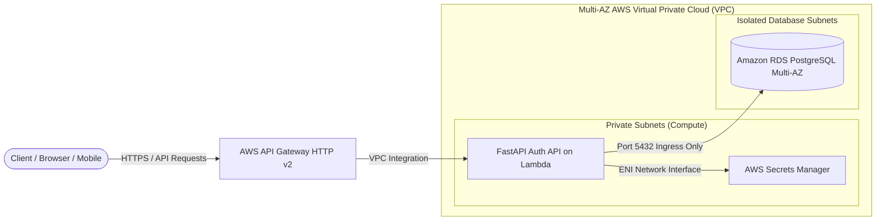
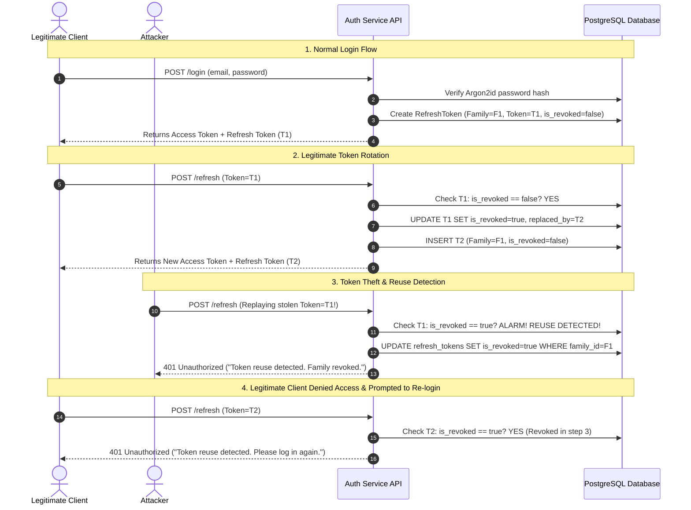

# Secure User Authentication & Role Management Service

A production-grade, secure authentication and Role-Based Access Control (RBAC) service built with Python 3.12+, FastAPI, SQLAlchemy 2.0, PostgreSQL, Argon2id, and JWT.

This service implements defense-in-depth security standards including **Argon2id password hashing**, **cryptographic refresh-token rotation with automatic token family reuse detection**, **server-side JWT revocation controls**, **IP-based sliding window rate limiting**, and **least-privilege AWS infrastructure**.

---

## Architecture

### System Topology



### Refresh Token Rotation & Token Family Reuse Detection Flow



---

## Security Model & Engineering Principles

### 1. Argon2id Password Hashing
Passwords are never stored in plaintext. They are hashed using **Argon2id**, the winner of the Password Hashing Competition (PHC) and the OWASP-recommended algorithm:
- `time_cost`: 3 iterations
- `memory_cost`: 65,536 KiB (64 MiB)
- `parallelism`: 4 threads
- `hash_len`: 32 bytes

Argon2id provides state-of-the-art protection against GPU, ASIC, and side-channel cracking attacks.

### 2. Refresh Token Rotation & Family Reuse Detection
Refresh tokens are single-use credentials:
1. Every token belongs to a `family_id` (UUID).
2. When a refresh token is used, it is immediately marked as `is_revoked = True` and replaced with a newly generated token in the same family.
3. If an attacker intercepts a previously used refresh token and attempts to replay it, the service detects that `is_revoked == True`.
4. The service immediately revokes **every token in that family**, invalidating active sessions across both legitimate and malicious actors, and emits a critical security audit log.

### 3. Server-Side JWT Revocation (Denylist)
Stateless JWT access tokens cannot be invalidated prior to expiration by signature verification alone. To solve this:
- Every issued access token includes a unique `jti` (JWT ID) claim.
- When a user logs out (`POST /logout`), the `jti` is inserted into a server-side `revoked_tokens` denylist table with its expiration timestamp.
- On every protected request, the authentication dependency checks the revocation denylist. If the `jti` is listed, the request is rejected with HTTP 401 Unauthorized.
- When an administrator modifies a user's role or deactivates an account, all active refresh tokens for that user are revoked immediately.

### 4. Sliding Window Rate Limiting
To defend against brute-force password guessing and credential stuffing:
- `/api/v1/auth/login`: Limited to 10 requests per minute per IP.
- `/api/v1/auth/register`: Limited to 5 requests per minute per IP.
- Exceeding the rate limit returns `HTTP 429 Too Many Requests` with a `Retry-After` header.

### 5. Role-Based Access Control (RBAC) Matrix
The service enforces strict role-based authorization using reusable FastAPI dependency injection:

| Endpoint | Method | USER | SUPPORT | ADMIN | Unauthenticated |
| :--- | :---: | :---: | :---: | :---: | :---: |
| `/api/v1/auth/register` | POST | Allow | Allow | Allow | Allow |
| `/api/v1/auth/login` | POST | Allow | Allow | Allow | Allow |
| `/api/v1/auth/refresh` | POST | Allow | Allow | Allow | Allow |
| `/api/v1/auth/me` | GET | Allow | Allow | Allow | Deny (401) |
| `/api/v1/admin/users` | GET | Deny (403) | **Allow** | **Allow** | Deny (401) |
| `/api/v1/admin/users/{id}` | GET | Deny (403) | **Allow** | **Allow** | Deny (401) |
| `/api/v1/admin/users/{id}/role` | PATCH | Deny (403) | Deny (403) | **Allow** | Deny (401) |
| `/api/v1/admin/users/{id}/status` | PATCH | Deny (403) | Deny (403) | **Allow** | Deny (401) |

### 6. Cookie & CSRF Security Controls
The API supports both `Authorization: Bearer <token>` headers and cookies:
- Cookies are configured with `HttpOnly=True` (prevents JavaScript access and XSS theft), `SameSite=Strict` (blocks cross-site request forgery), and `Secure=True` in production.
- For single-page applications (SPAs) storing tokens in cookies, `SameSite=Strict` guarantees cookies are not attached to cross-origin requests, mitigating CSRF without complex anti-forgery tokens.

---

## Technology Stack

- **Runtime & Framework**: Python 3.12+, FastAPI, Pydantic v2, Pydantic Settings
- **Password Hashing**: Argon2id (`argon2-cffi`)
- **Tokens**: PyJWT (`cryptography` backend)
- **Database & ORM**: PostgreSQL 16, SQLAlchemy 2.0 (asyncio with `asyncpg`), Alembic, `aiosqlite` for zero-dependency local testing
- **ASGI Lambda Adapter**: Mangum
- **Cloud Infrastructure**: AWS API Gateway HTTP v2, AWS Lambda (inside VPC), AWS Secrets Manager, Amazon RDS PostgreSQL Multi-AZ, Amazon VPC, AWS CloudWatch, IAM
- **Testing & Quality**: Pytest, HTTPX, Ruff

---

## Project Structure & Module Responsibilities

```text
secure-auth-rbac-service/
├── app/
│   ├── api/
│   │   ├── deps.py               # Auth & RBAC dependencies: get_current_user, require_role, get_db
│   │   ├── routes_admin.py       # User management, role elevation, and deactivation
│   │   ├── routes_auth.py        # /register, /login, /refresh, /logout, /me
│   │   └── routes_health.py      # Liveness and readiness probes
│   ├── core/
│   │   ├── config.py             # Pydantic Settings: JWT expiration, secret keys, rate limits
│   │   ├── security.py           # Argon2id password hashing, JWT encoding/decoding, token hashing
│   │   └── token_service.py      # Refresh token rotation, family reuse detection, revocation denylist
│   ├── middleware/
│   │   ├── correlation.py        # X-Correlation-ID request tracing
│   │   ├── rate_limiter.py       # Sliding window rate limiter for login/registration
│   │   └── security_headers.py   # OWASP response headers (HSTS, CSP, X-Frame-Options, nosniff)
│   ├── models/
│   │   ├── revoked_token.py      # RevokedToken entity (JWT JTI denylist)
│   │   ├── token.py              # RefreshToken entity (family_id, token_hash, is_revoked)
│   │   └── user.py               # User entity and UserRole StrEnum
│   ├── schemas/
│   │   ├── common.py             # PaginatedResponse[T], PaginationParams, ErrorResponse
│   │   ├── token.py              # TokenResponse, RefreshTokenRequest, TokenPayload
│   │   └── user.py               # UserRegister, UserLogin, UserRead, RoleUpdate
│   ├── database.py               # Async engine, sessionmaker, and Base model
│   ├── logging_config.py         # JSON logging with automated password/token masking
│   └── main.py                   # FastAPI app factory, CORS, exception handlers, Mangum adapter
├── alembic/                      # Database migrations
├── terraform/
│   ├── modules/                  # Modules: vpc, rds, secrets_manager, lambda_api, api_gateway
│   └── environments/             # Environments: dev, qa, prod
├── tests/                        # 21 comprehensive unit, integration, and security tests
├── Dockerfile                    # Multi-stage production container
├── docker-compose.yml            # Local PostgreSQL + API service stack
├── Makefile                      # Standardized developer commands
├── api_requests.http             # Runnable HTTP request examples
├── postman_collection.json       # Postman v2.1 collection
└── pyproject.toml                # Dependencies, Ruff, and Pytest configuration
```

---

## Local Setup & Execution Guide

### Option 1: Zero-Dependency Local Mode (Instant Run)

Run the service locally without Docker or AWS credentials using SQLite:

1. **Activate Python 3.12 Virtual Environment**:
   ```bash
   python -m venv .venv
   # Windows:
   .venv\Scripts\activate
   # Linux/macOS:
   source .venv/bin/activate
   ```

2. **Install Dependencies**:
   ```bash
   pip install -r requirements.txt -r requirements-dev.txt
   ```

3. **Configure Environment Variables**:
   Copy `.env.example` to `.env`:
   ```ini
   ENVIRONMENT=development
   DATABASE_URL=sqlite+aiosqlite:///./auth.db
   JWT_SECRET_KEY=local-dev-super-secret-key-at-least-32-chars-long
   LOG_LEVEL=INFO
   ```

4. **Start the API Server**:
   ```bash
   uvicorn app.main:app --host 0.0.0.0 --port 8000 --reload
   ```
   Open Swagger UI at `http://localhost:8000/docs`.

---

### Option 2: Docker Compose with PostgreSQL

```bash
docker compose up -d --build
docker compose ps
docker compose logs -f api
```

---

## Sample API Requests & Responses

### 1. User Registration (`POST /api/v1/auth/register`)
**Request:**
```http
POST /api/v1/auth/register HTTP/1.1
Host: localhost:8000
Content-Type: application/json
X-Correlation-ID: 9b2d8e41-01f2-49bb-b179-880947702f21

{
  "email": "sarah.connor@example.com",
  "password": "SecurePassword123!"
}
```

**Response (HTTP 201 Created):**
```json
{
  "access_token": "eyJhbGciOiJIUzI1NiIsInR5cCI6IkpXVCJ9...",
  "refresh_token": "j8Km2L_9aPqX4vN8sW3eR5tY7uI1oP2aD4fG6hJ8kL0zX2cV4bN6mQ8wE0rT2yU4",
  "token_type": "bearer",
  "expires_in": 900
}
```

### 2. Refresh Token Rotation (`POST /api/v1/auth/refresh`)
**Request:**
```http
POST /api/v1/auth/refresh HTTP/1.1
Host: localhost:8000
Content-Type: application/json

{
  "refresh_token": "j8Km2L_9aPqX4vN8sW3eR5tY7uI1oP2aD4fG6hJ8kL0zX2cV4bN6mQ8wE0rT2yU4"
}
```

**Response (HTTP 200 OK):**
```json
{
  "access_token": "eyJhbGciOiJIUzI1NiIsInR5cCI6IkpXVCJ9...",
  "refresh_token": "m4Np9Q_1bRtY6uI8oP0aS2dF4gH6jK8lZ0xC2vB4nM6wE8rT0yU2iO4pA6sD8fG0",
  "token_type": "bearer",
  "expires_in": 900
}
```

### 3. Replaying an Already Rotated Token (Theft Detection)
Replaying `j8Km2L_9aPqX4vN8sW3eR5tY7uI1oP2aD4fG6hJ8kL0zX2cV4bN6mQ8wE0rT2yU4` triggers immediate reuse detection:
```http
HTTP/1.1 401 Unauthorized
Content-Type: application/json

{
  "detail": "Security alert: Refresh token reuse detected. All sessions in this family have been revoked."
}
```

---

## Automated Testing & Quality Checks

Run the 21 automated tests:
```bash
pytest -v
```

Execute Ruff linting and formatting:
```bash
ruff check .
ruff format --check .
```

---

## Terraform Infrastructure as Code

Multi-environment architecture in `terraform/`:
- Multi-AZ VPC with isolated public, private compute, and database subnets
- Managed Amazon RDS PostgreSQL instance with KMS storage encryption, security groups, and automated backups
- AWS Secrets Manager storing DB credentials and JWT signing secret
- Lambda inside private VPC subnets with least-privilege IAM policies
- HTTP API Gateway v2 with CORS and CloudWatch stage logging

Validate configurations:
```bash
terraform -chdir=terraform/environments/dev validate
terraform -chdir=terraform/environments/qa validate
terraform -chdir=terraform/environments/prod validate
```

---

## Technical Interview Questions & Answers

### Q1: Why is Argon2id preferred over bcrypt or PBKDF2 for password hashing in modern systems?
**Answer**: Argon2id is a hybrid of Argon2i (resistant to side-channel timing attacks) and Argon2d (resistant to GPU/ASIC brute-force cracking via memory-hard computational puzzles). While bcrypt and PBKDF2 are compute-hard, they require very little memory (only 4 KB). As a result, attackers can build specialized ASIC or GPU clusters with thousands of parallel cores to crack millions of hashes per second. Argon2id requires configurable high memory (such as 64 MiB per hash), making mass parallel hardware attacks economically and physically unfeasible.

### Q2: How does Refresh Token Rotation with Token Family Reuse Detection prevent session hijacking?
**Answer**: In standard refresh token implementations, a stolen refresh token gives an attacker perpetual access until expiration. With Token Family Rotation, every time a token is exchanged, it is invalidated and replaced. If an attacker and a legitimate user both possess a token from the same lineage, one of them will inevitably attempt to use an already-invalidated token. When the server encounters an invalidated token, it recognizes that a token in this family has been used twice (reuse detection). Instead of merely rejecting that single request, it revokes the **entire token family**, immediately locking out the attacker and protecting the user account.

### Q3: Why is a stateless JWT architecture insufficient for immediate revocation, and how does this service address it?
**Answer**: By design, JWT verification is stateless: any service with the public key or secret can verify the signature and expiration without querying a database. The fundamental drawback is that if a token is compromised, a user is banned, or a user changes their role, the token remains valid until `exp` elapses. This service solves this by implementing short-lived access tokens (15 minutes) paired with a server-side revocation denylist (`revoked_tokens` table) that checks the `jti` claim upon logout. Furthermore, sensitive administrative actions (such as role modifications) immediately invalidate all refresh tokens, preventing privilege persistence.
